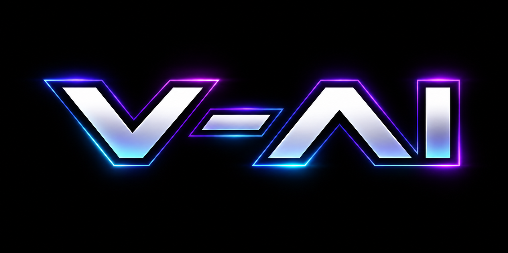

<p align="center"></p>

# V-IA

**Hace que un agente de IA trabaje con ODD (Organic Driven Development) y, donde se puede, que lo cumpla de verdad.**

V-IA es un binario de Go (`v-ia`) que configura los agentes de IA que ya usas (Claude Code, OpenCode, Codex, Gemini CLI…) para que sigan un método de trabajo concreto, y en Claude Code **bloquea por mecanismo** lo que el método prohíbe.

> Manual completo con todos los comandos, archivos y reglas: [`docs/manual.md`](docs/manual.md).

---

## 1. Qué problema resuelve

Un agente de IA, por defecto:

- edita archivos cuando solo le pediste que te explicara algo;
- hace `commit` o `push` sin que se lo pidas;
- marca una tarea como "hecha" sin haberla comprobado;
- olvida lo decidido al cerrar la sesión;
- ejecuta comandos destructivos (`rm -rf`, `git push --force`) si cree que ayudan.

Escribirle reglas en un archivo de instrucciones ayuda, pero **es una petición**: el agente puede ignorarla. V-IA añade lo que falta: **hooks que lo impiden**.

## 2. Qué es ODD y qué hace V-IA con él

**ODD** son ocho reglas cortas (sí/no) que el agente sigue en orden:

1. **Autorizar** — una consulta no es permiso para editar.
2. **Explorar** — leer el código antes de modificar.
3. **Aclarar** — resolver dudas investigando; preguntar solo si la decisión es tuya.
4. **Clasificar** — Lectura, Acotado o Seguimiento.
5. **Conservar** — en Seguimiento, crear una ficha `odd/tasks/<feature>.md` antes de editar.
6. **Implementar y comprobar** — con prueba primero si hay una ejecutable.
7. **Cerrar** — `[x]` solo con evidencia observada.
8. **Entrega** — commit/push/PR solo si lo pides explícitamente.

V-IA hace tres cosas:

| Capa | Qué hace |
|---|---|
| **Instrucciones** | Escribe las reglas ODD en el archivo global de cada agente (entre marcadores, sin tocar lo tuyo). |
| **Hooks (solo Claude Code)** | Bloquean ediciones en modo lectura, commits no pedidos, comandos destructivos y cierres sin evidencia. |
| **Herramientas** | `task`, `guard`, `review`, `skill-registry`… que el agente (o tú) ejecutan para comprobar. |

Además incluye **RDD** (revisión con recibo ligado al cambio exacto), **12 skills**, un **subagente revisor**, integración opcional con **Engram** (memoria), **Context7** (documentación por MCP) y **CodeGraph** (grafo de código) y una **deny-list** de archivos sensibles.

## 3. Qué agentes soporta

| Agente | Cumplimiento | Verificado |
|---|---|---|
| **Claude Code** | **Bloqueo por hooks** + skills + subagente revisor | Sí: E1, E2, E3, E7 con Claude real |
| OpenCode | Solo instrucciones | Sí: E1–E4 con OpenCode 1.19.5 |
| Codex, Gemini CLI, Kilo, Qwen, Windsurf | Solo instrucciones | **No**: ruta tomada de la documentación de Gentle-AI, no ejecutados |
| Cualquier otro | `AGENTS.md` en el proyecto (`--agent generic`) | No |

"Solo instrucciones" significa que el agente *debería* obedecer, pero nada se lo impide.

---

## 4. Instalación

### 4.0 Inicio rápido (dos comandos)

```bash
curl -fsSL https://raw.githubusercontent.com/victorcarrillodev/V-IA/main/install.sh | sh
v-ia
```

El primero descarga el binario precompilado de la última release a `~/.local/bin` (sin Go, sin sudo; Linux/macOS, amd64/arm64). El segundo abre la terminal interactiva: elige **Instalar / configurar agentes**, revisa el diff y aplica. Si `~/.local/bin` no está en tu `PATH`, el instalador te lo indica.

> **Estado:** el script y el flujo de publicación (`.goreleaser.yaml`, `.github/workflows/release.yml`) están en el repo, pero el comando solo funciona cuando el repositorio es público y existe una release publicada (se crea al subir una etiqueta `v*`, p. ej. `v0.3.0`). Hasta entonces, usa 4.1–4.2. El script verifica el `sha256` de la descarga contra `checksums.txt` (probado con una release simulada, no con una real).

### 4.1 Requisitos (solo para compilar desde el código fuente)

- Linux (no probado en macOS ni Windows).
- **Go 1.27 o superior** (`go version`). Si no lo tienes y no puedes usar el gestor de paquetes, descarga el tarball oficial desde <https://go.dev/dl/> y descomprímelo en `~/.local/go-sdk`:
  ```bash
  mkdir -p ~/.local/go-sdk && tar -C ~/.local/go-sdk -xzf go1.27.4.linux-amd64.tar.gz
  export PATH="$HOME/.local/go-sdk/go/bin:$PATH"      # añádelo a tu ~/.zshrc o ~/.bashrc
  ```
- `git`.
- Al menos un agente instalado (p. ej. `claude`).
- Opcional: [`engram`](https://github.com/Gentleman-Programming/engram) para memoria entre sesiones.

### 4.2 Compilar e instalar el binario

```bash
git clone https://github.com/victorcarrillodev/V-IA.git
cd V-IA
go build -o ~/.local/bin/v-ia ./cmd/v-ia
v-ia version            # → v-ia 0.3.0
v-ia                    # abre la terminal interactiva (ver sección 5)
```

`~/.local/bin` debe estar en tu `PATH`. **El binario tiene que llamarse `v-ia`**: los hooks lo invocan por ese nombre.

> `go install` no funciona con este repo porque el módulo se llama `v-ia`, no la URL de GitHub. Usa `go build`.

### 4.3 Configurar tus agentes

Siempre en dos pasos: primero **mirar**, luego **aplicar**.

```bash
v-ia install --dry-run      # muestra el diff exacto; no escribe nada
v-ia install --yes          # aplica (hace backup antes)
v-ia doctor                 # comprueba que todo quedó bien
```

Por defecto instala solo para **Claude Code**. Para más agentes:

```bash
v-ia install --agent claude-code,opencode,codex --yes
```

Qué escribe para Claude Code:

| Archivo | Contenido |
|---|---|
| `~/.claude/CLAUDE.md` | Bloque ODD entre marcadores `<!-- v-ia:managed … -->`. Tu contenido no se toca. |
| `~/.claude/settings.json` | 4 hooks (`PreToolUse`, `UserPromptSubmit`, `Stop`, `SessionStart`) + deny-list de archivos sensibles. |
| `~/.claude/skills/<skill>/SKILL.md` | 12 skills: `odd-resume`, `odd-verify`, `odd-delegate`, `rdd-review`, `work-unit-commits`, `branch-pr`, `issue-creation`, `chained-pr`, `judgment-day`, `skill-creator`, `comment-writer`, `rdd-defect-workflow`. |
| `~/.claude/agents/v-ia-reviewer.md` | Subagente revisor independiente (solo lectura). |

> ⚠️ `settings.json` se reescribe con las claves en **orden alfabético** (el contenido se conserva, el formato cambia). Si tienes comentarios o un JSON no estricto, V-IA se niega a tocarlo.

Opciones: `--no-hooks`, `--no-permissions`, `--force`, `--engram`, `--context7`, `--codegraph`, `--all`. Para instalar solo lo que falte de los opcionales: `v-ia deps`. Detalle en el [manual](docs/manual.md#instalación-y-ciclo-de-vida).

### 4.4 Componentes opcionales: Engram, Context7, CodeGraph

```bash
v-ia deps               # qué falta y qué se ejecutaría; pregunta antes de instalar
v-ia deps --yes         # instala lo que falte (sin sudo)
v-ia install --yes --all    # configura agentes e instala los componentes de una vez
```

| Componente | Qué aporta | Si falta, V-IA lo instala con |
|---|---|---|
| **Engram** | Memoria entre sesiones | `go install` (en `~/.local/bin`) o `brew` |
| **Context7** | Documentación actual de librerías | MCP remoto de Claude Code (no necesita Node) |
| **CodeGraph** | Grafo de conocimiento del código | `npm` o su instalador oficial |

Nunca usa `sudo` y solo falla si no puede instalar algo por ti (por ejemplo, sin `claude`). También son casillas en la terminal interactiva, y `v-ia doctor` informa de su estado. CodeGraph escribe además instrucciones propias en `~/.claude/CLAUDE.md`. Detalle y límites en el [manual](docs/manual.md#componentes-opcionales-engram-context7-codegraph).

> Verificado: Engram y Context7 se instalaron de verdad en un HOME temporal. CodeGraph no se ha ejecutado contra su instalador real.

### 4.4b Actualizar

```bash
v-ia update --check     # ¿hay versión nueva?
v-ia update             # descarga la release, verifica sha256 y reemplaza el binario
v-ia sync --yes         # refresca los archivos gestionados
```

Requiere una release publicada. Desde el código fuente: `v-ia upgrade --src <repo>`.

### 4.5 Deshacer

```bash
v-ia uninstall --yes            # quita bloques, hooks, skills y subagente (lo editado a mano se conserva)
v-ia restore --list             # lista backups
v-ia restore latest --yes       # vuelve al estado anterior, byte a byte
```

---

## 5. La terminal interactiva

Ejecuta `v-ia` sin argumentos en un terminal y se abre un panel con el logo y un menú:

| Opción | Qué hace |
|---|---|
| Instalar / configurar agentes | Asistente: agentes → componentes (hooks, archivos sensibles, Engram, Context7, CodeGraph) → revisión del diff y comandos → aplicar. |
| Estado del sistema | El diagnóstico de `doctor`, con refresco (`r`). |
| Proyecto actual | Modo, interruptor RDD, recibo (vigente u obsoleto), riesgo y fichas del directorio donde lo abriste. |
| Sincronizar / Desinstalar | Mismo flujo de revisión y aplicación, con backup. |
| Restaurar último backup | Con confirmación previa. |

Teclas: `↑↓` o `j/k` mover · `enter` elegir · `espacio` marcar · `esc` volver · `q` salir. El logo se adapta al tamaño del terminal (grande ≥112×40, mediano ≥70×28 o una línea) y todo el panel queda centrado en horizontal y vertical, con un ancho que escala con la ventana. En Ghostty y kitty el logo se dibuja como **imagen real** (protocolo gráfico de kitty); en el resto, con medios bloques en color verdadero y, sin color (`NO_COLOR`), con formas sombreadas. `V_IA_IMAGES=0` fuerza los bloques y `V_IA_IMAGES=1` fuerza la imagen. Mínimo 60×18.

> Ábrelo dentro de la carpeta de tu proyecto si quieres ver el panel "Proyecto actual" de ese proyecto.

## 6. Cómo se usa en el día a día

Con los hooks instalados **no cambias nada de cómo trabajas**: hablas con Claude Code igual. V-IA actúa por detrás.

| Tú dices… | V-IA hace… |
|---|---|
| "Explícame cómo funciona el login" | Modo **lectura**: bloquea cualquier edición. Al cerrar, comprueba que nada cambió. |
| "Propón mejoras, sin modificar archivos" | Igual. "Sin modificar" gana siempre. |
| "Corrige el texto del botón" | Modo **edición**: permite editar. |
| (trabajo largo, varias sesiones) | Tú o el agente ejecutan `v-ia mode tracking` y `v-ia task new <feature> --request "<tu petición>"`. Sin ficha no se edita. |
| "Haz commit" | Autoriza commit **solo en ese mensaje**. Si el proyecto tiene comprobaciones, exige un recibo válido. |
| (el agente intenta `git push` sin que lo pidas) | Bloqueado. |
| (el agente intenta `rm -rf /`, `push --force`, `reset --hard`…) | Bloqueado siempre; te lo pide a ti. |

### Flujo típico de una feature larga

```bash
cd mi-proyecto
v-ia mode tracking
v-ia task new "login con google" --request "Quiero login con Google. El botón dice 'Entrar con Google'."
#   → crea odd/tasks/login-con-google.md  (Specs, Tareas, Evidencia, Log)
# … el agente implementa, rellena la ficha y marca [x] solo con evidencia …
v-ia task status          # avance de cada ficha
v-ia task check           # valida las fichas
v-ia review check         # build/vet/test + riesgo + recibo
v-ia mode edit            # al terminar el seguimiento
```

### Antes de entregar

```bash
v-ia review check
```
- Ejecuta las comprobaciones del proyecto, evalúa el **riesgo** (`passive`, `medium`, `high`) y emite un **recibo** ligado al contenido exacto del árbol: si cambia un solo byte, el recibo deja de valer.
- Si el riesgo es **alto**, el agente debe lanzar el subagente `v-ia-reviewer`, que revisa con las lentes 4R y registra su veredicto (`v-ia review ack`). Sin eso, el hook no deja hacer commit.
- Un recibo `pass` **nunca** autoriza commit ni push: eso lo decides tú en tu mensaje.

---

## 6b. Estándares del proyecto (`v-ia standards`)

Reglas propias del proyecto (dónde van los archivos, patrones prohibidos, criterios en lenguaje natural) revisadas antes de entregar:

```bash
v-ia standards init       # crea .v-ia/standards.md con ejemplos
v-ia standards check      # revisa lo que está en staging
v-ia standards install    # pre-commit de Git (avisa; --strict bloquea)
```

Las reglas `path` y `deny` se evalúan en local **sin gastar tokens**; solo las `ai` usan un agente, con una única llamada barata por revisión y caché. Si el agente falla, no bloquea. Detalle en el [manual](docs/manual.md#estándares-del-proyecto-v-ia-standards).

## 7. Qué comprobar si algo falla

| Síntoma | Causa probable | Solución |
|---|---|---|
| `v-ia: command not found` | `~/.local/bin` no está en el PATH | Añádelo al PATH |
| El agente no queda bloqueado | Hooks no instalados | `v-ia doctor` → `v-ia install --yes` |
| Hook bloquea una edición legítima | Tu mensaje se clasificó como lectura | Reformula (p. ej. "corrige…") o `v-ia mode edit` |
| No deja hacer commit | Falta tu petición, o falta recibo | Di "haz commit" y ejecuta `v-ia review check` |
| `review check`: "no hay comprobaciones" | El proyecto no tiene `go.mod` ni `package.json` con test | Crea `.v-ia/checks.txt` (un comando por línea) |
| "El bloque … fue editado a mano" | Editaste el contenido entre marcadores | `v-ia install --force` (con backup) |
| `settings.json no es JSON válido` | Tiene comentarios o está roto | Arréglalo; V-IA no lo toca mientras tanto |

Más en el [manual](docs/manual.md#solución-de-problemas).

---

## 8. Límites conocidos

Lee esto antes de fiarte:

- **Solo Claude Code se hace cumplir por bloqueo.** El resto depende de que el modelo obedezca.
- **La clasificación lectura/edición es por palabras clave**; una frase ambigua puede clasificarse mal. Solo se afina usándolo.
- **Un `sed -i` desde Bash en modo lectura no se bloquea al instante**: lo detecta el hook de cierre (`Stop`).
- **`task check` valida la forma de la evidencia, no que el comando se ejecutara de verdad.**
- Engram no está probado con el binario real; solo con uno simulado.
- Codex, Gemini, Kilo, Qwen y Windsurf: rutas sin verificar con el agente real.
- Aún no hay release publicada: hasta entonces se compila desde el código fuente (4.1–4.2). El instalador de una línea no se ha probado contra una release real.
- **Frente a Gentle-AI** (el proyecto que inspiró este): V-IA es mucho más pequeño. Tiene 12 skills (ellos, una biblioteca amplia), 2 agentes verificados con agentes reales (ellos, 17), solo Linux probado (ellos, macOS/Linux/Windows con releases firmadas), un RDD local con recibo (ellos, transacciones atómicas y proveedores de revisión) y sin benchmarks, personas ni telemetría. Su diferencia es el bloqueo duro por hooks en Claude Code, `v-ia standards` y `v-ia deps`.
- El logo como imagen real solo está pensado para Ghostty y kitty; no funciona dentro de tmux (ahí se usan bloques).

## 9. Desarrollo y pruebas

```bash
go build ./... && go vet ./... && go test ./...      # incluye pruebas anti-huérfanos (internal/lifecycle/orphans_test.go)
V_IA_BIN=$PWD/v-ia ./scripts/e2e-claude.sh           # E1,E2,E3,E7 con Claude real (consume tokens)
V_IA_BIN=$PWD/v-ia ./scripts/e2e-opencode.sh         # E1–E4 con OpenCode real (modelo gratuito)
```

`internal/lifecycle/orphans_test.go` falla si una skill o archivo embebido queda sin usar, o si un comando no está documentado en el manual.

Los scripts end-to-end instalan los hooks **solo en un proyecto temporal** y no tocan tu configuración.

## Inspiración y créditos

V-IA nace de la idea y el trabajo de **[Gentle-AI](https://github.com/Gentleman-Programming/gentle-ai)** (Gentleman Programming): configurar los agentes de IA que ya usas para que sigan un método de trabajo, la memoria con [Engram](https://github.com/Gentleman-Programming/engram) y las rutas de configuración de varios agentes. V-IA es un proyecto independiente y no oficial, con su propio método (ODD + RDD) y su propio código; no está afiliado a Gentle-AI ni a sus autores. Gracias por el camino que abrieron.

## 10. Documentos del repositorio

| Archivo | Contenido |
|---|---|
| [`docs/manual.md`](docs/manual.md) | Manual completo: comandos, reglas, archivos, formatos |
| [`docs/capabilities.md`](docs/capabilities.md) | Qué está verificado y qué no, por agente |
| [`PLAN.md`](PLAN.md) | Plan original y decisiones de diseño |

Licencia: sin definir todavía.
